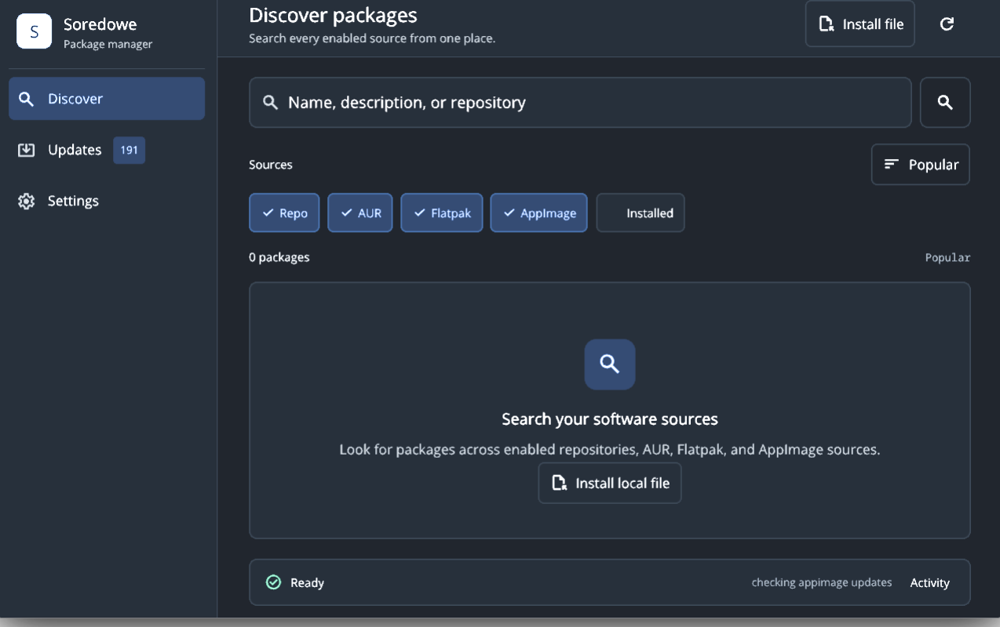
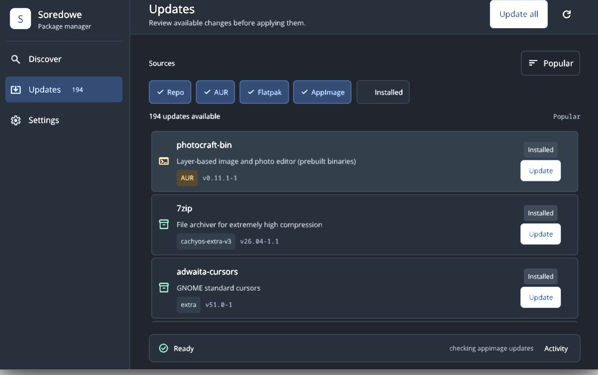

# Soredowe

A native desktop package manager for Arch Linux. Search, install, remove, and update packages from pacman repositories, the AUR, Flatpak, and AppImage in one place.



## Install

### AUR

```bash
paru -S soredowe-bin
```

```bash
yay -S soredowe-bin
```

### Build from source

Requires Arch Linux, Rust 1.98 or newer, a Wayland session, and a Vulkan-capable GPU.

```bash
git clone https://github.com/mlm-games/soredowe
cd soredowe
cargo build --release --locked -p app_shell
sudo install -Dm755 target/release/soredowe-desktop /usr/bin/soredowe
```

## Features

- One search across pacman repositories, the AUR, Flatpak, and installed AppImages.
- Install, remove, and upgrade packages.
- Review available updates and apply them together.
- Install local package files and AppImages.
- Native Rust UI built with [Repose](https://github.com/mlm-games/repose).



## Links

- [AUR package](https://aur.archlinux.org/packages/soredowe-bin)
- [Issues](https://github.com/mlm-games/soredowe/issues)

## License

GPL-3.0
